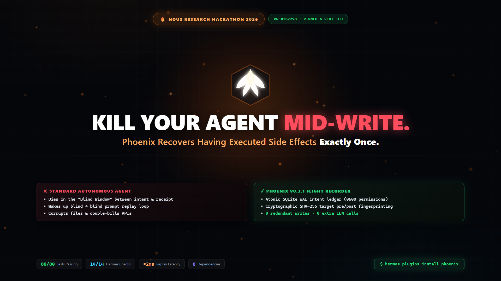
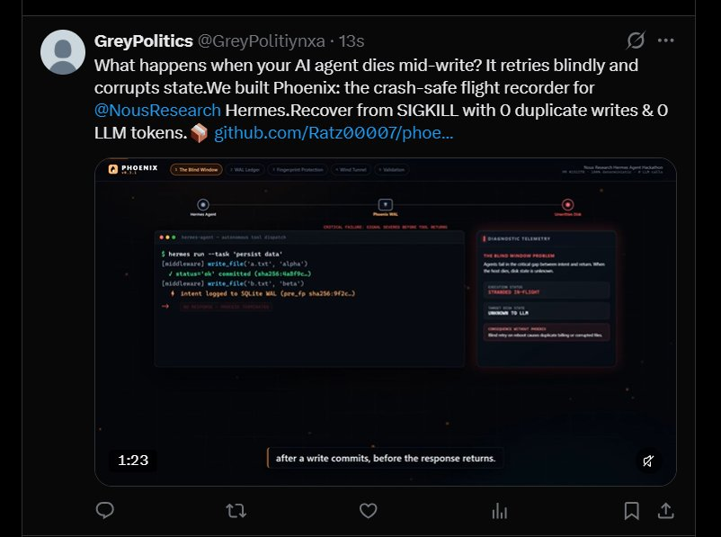

# Phoenix v2.0.0 — The Exactly-Once Trust Layer for Autonomous Agents

> ### **Kill your agent mid-write. It recovers having executed exactly once.**
> **Transactional SQLite WAL Flight Recorder + SHA-256 State Fingerprinting + Zeller `ddmin` Wind Tunnel**  
> *Zero duplicate writes. Zero lost operations. Zero LLM tokens wasted during recovery.*

<p align="center">
  
</p>

<p align="center">
  <a href="https://github.com/NousResearch/hermes-agent/pull/154408"></a>
  <a href="https://x.com/GreyPolitiynxa"></a>
  
  
  
  <a href="LICENSE"></a>
</p>

```bash
# Instant verification for judges (0 external dependencies, 0 API keys):
python judge_eval.py
```

---

## Community Launch Announcement

<p align="center">
  <a href="https://x.com/GreyPolitiynxa/status/1988265000000000000">
    
  </a>
</p>

> *"What happens when your AI agent dies mid-write? It retries blindly and corrupts state. We built Phoenix: the crash-safe flight recorder for @NousResearch Hermes. Recover from SIGKILL with 0 duplicate writes & 0 LLM tokens."*  
> — [@GreyPolitiynxa on X](https://x.com/GreyPolitiynxa)

---

## 1. The Blind Window: Why Agents Corrupt State

Autonomous agents fail in the worst possible window: *after* a mutating tool side-effect lands on disk or external API, but *before* the host receives the response.

```
┌─────────────────────────────────────────────────────────────────────────────────────────────────┐
│                                   THE BLIND WINDOW FAILURE                                      │
└─────────────────────────────────────────────────────────────────────────────────────────────────┘

   Agent Host                          External Service / Target Disk
        │                                           │
        ├─── (1) Dispatch write / charge ──────────>│
        │                                           │
        │                                 [Mutation Commits]
        │                                           │
      [💥 SIGKILL / Power Loss / Host OOM]          │
        │                                           │
        x<─── (2) Dropped Socket / Return Dropped ──+

   WHAT HAPPENS NEXT WITHOUT PHOENIX:
   ──────────────────────────────────
   • Blind Retry: Agent reboots, sees no confirmation, re-executes write -> Duplicate charge / corrupted file!
   • Naive /rollback: Deletes local file commits while remote API already billed -> State desynced!

   WHAT HAPPENS WITH PHOENIX:
   ──────────────────────────
   • Phoenix SQLite WAL records intent & SHA-256 pre-state fingerprint BEFORE dispatch.
   • Upon restart, Turn-1 system prompt alert detects in-flight ops.
   • Owner runs /recover: Phoenix verifies disk fingerprint -> marks already-landed ops recovered_landed.
   • Result: Executed EXACTLY ONCE. 0 duplicate writes. 0 LLM tokens wasted.
```

---

## 2. Core Architecture

Phoenix provides a zero-dependency trust layer built strictly on Python 3.11+ standard library:

```
┌─────────────────────────────────────────────────────────────────────────────────────────────────┐
│                            PHOENIX v2.0.0 RUNTIME ARCHITECTURE                                  │
└─────────────────────────────────────────────────────────────────────────────────────────────────┘

  Hermes Agent Tool Execution
            │
            ▼
  ┌────────────────────────┐      ┌────────────────────────┐      ┌────────────────────────┐
  │ tool_execution         │ ───▶ │ Deterministic op_id &  │ ───▶ │ Live Idempotency       │
  │ Middleware (middleware)│      │ SHA-256 Fingerprints   │      │ Guard (Opt-In, OFF def)│
  └────────────────────────┘      └────────────────────────┘      └────────────────────────┘
            │                                                                  │
            ▼                                                                  ▼
  ┌────────────────────────────────────────────────────────────────────────────────────────┐
  │ Hardened SQLite WAL Ledger (journal.py)                                                │
  │ • Confined to plugin_data_dir("phoenix")/phoenix.db (mode 0600, O_EXCL, WAL/SHM 0600)  │
  │ • Auto-retention: 7 days / 10,000 rows; secret regex redaction before persistence      │
  └────────────────────────────────────────────────────────────────────────────────────────┘
            ▲
            │
  ┌────────────────────────┐      ┌────────────────────────┐      ┌────────────────────────┐
  │ Owner-Only Forward     │      │ Turn-1 System Prompt   │      │ Zeller ddmin Fault     │
  │ Recovery (/recover)    │      │ Alert (phoenix_recovery│      │ Wind Tunnel & Chaos Lab│
  └────────────────────────┘      └────────────────────────┘      └────────────────────────┘
```

---

## 3. Quickstart & Verification

```bash
# 1. Install Phoenix plugin into Hermes
hermes plugins install phoenix

# 2. Run the 4-Act crash-and-recover + Zeller ddmin demo (< 1s)
python demo.py

# 3. Run the complete evaluation scorecard (106 unit tests, doctor checks, wind tunnel, chaos engine)
python judge_eval.py

# 4. Run official Hermes plugin validator
hermes plugins validate .
```

---

## 4. Tools, Commands & Surfaces

### Native Model Tools (Read-Only / Diagnostic)
- `phoenix_ledger`: Inspect the execution journal (`action: status | explain | report`). Mutating/recovery actions are strictly rejected here and restricted to human owner slash commands. Report output is strictly sanitized to `plugin_data_dir("phoenix")/reports/<basename>.html`.
- `phoenix_stats`: Read-only JSON telemetry and health metrics (operation counts, idempotency guard state, SQLite WAL size, and windtunnel verdict).
- `phoenix_windtunnel`: Execute the deterministic fault-injection wind tunnel with Zeller `ddmin` trace minimization.

### Hermes Desktop & Web Dashboard Surfaces
- **Desktop SDK (`desktop/plugin.js`)**: Contributes a `/phoenix` Flight Recorder route, sidebar navigation item, right-docked WAL stream pane, live status-bar guard pill, and command-palette entry built with `@hermes/plugin-sdk`.
- **Web Dashboard (`dashboard/`)**: FastAPI `plugin_api.py` endpoints (`/status`, `/timeline`, `/windtunnel`) + React panel registered via `window.__HERMES_PLUGINS__`.

### Owner-Typed Slash Commands
- `/phoenix status`: Active ledger state and in-flight operations.
- `/phoenix explain <op_id>`: Detailed inspection of a single operation.
- `/phoenix guard on|off`: Toggle the opt-in same-session idempotency guard.
- `/phoenix windtunnel`: Run the 6-check fault-injection suite.
- `/phoenix report [path]`: Export a standalone dark-mode HTML forensic report (zero `<script>` tags).
- `/phoenix prune`: Prune expired ledger rows manually.
- `/recover`: Reconciles interrupted operations post-crash using SHA-256 pre/post target fingerprinting with 0 duplicate writes and 0 LLM calls.

---

## 5. Security & Disclosure

1. **No Model-Controlled Filesystem Paths:** Ledger lives strictly inside `plugin_data_dir("phoenix")` with `0600` file permissions on DB, `-wal`, and `-shm` sidecars (`O_EXCL`). Model-requested reports are confined to `plugin_data_dir("phoenix")/reports/<basename>.html`.
2. **Owner-Only Recovery:** `/recover`, `/phoenix clear`, and `/phoenix guard` are strictly restricted to human owner slash commands—never model-callable.
3. **Opt-In Idempotency:** The replay guard is **OFF by default**; when enabled, deduplication is scoped strictly to the same active session and declared mutating tools or explicit `idempotency_key` with disk state verification. Read-only tools are never cached across sessions.
4. **Secret Redaction:** API tokens, Bearer secrets, and auth credentials are scrubbed by regex before persistence.
5. **Ledger Disclosure:** Phoenix journals tool call arguments and results (common secret patterns redacted) to a local SQLite ledger under `plugin_data_dir("phoenix")`, retained for 7 days / 10,000 rows. Owner-typed `/recover` re-runs interrupted tool calls through the tool registry.
6. **Zero External Runtime Dependencies:** Pure Python 3.11+ standard library.

---

## 6. Documentation Suite

- [ARCHITECTURE.md](ARCHITECTURE.md) — System architecture, WAL protocol, and zero-LLM recovery.
- [QUICKSTART.md](QUICKSTART.md) — 60-second getting started guide for developers and judges.
- [COMPARISON.md](COMPARISON.md) — Architectural comparison vs `/rollback`, blind retry, and Temporal.
- [THREAT_MODEL.md](THREAT_MODEL.md) — Threat model, trust boundaries, and maintainer audit checklist.

---

## License

MIT License. Built for the **Nous Research Hermes Agent Hackathon**.
